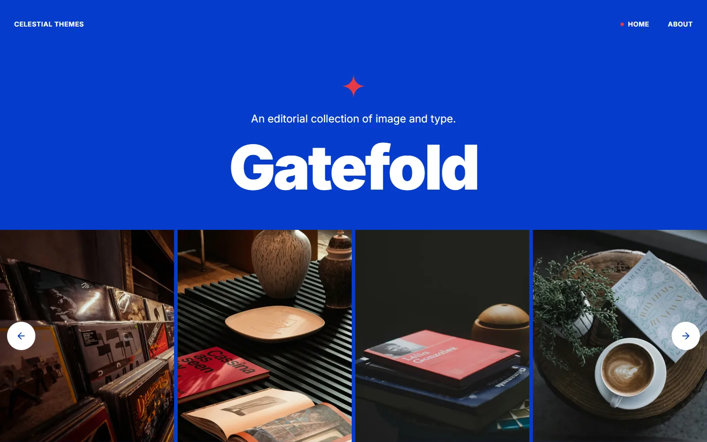

# Gatefold

A free two-page HTML portfolio template. Plain files — no framework, no bundler,
no package manager needed to use it. Open `Template/index.html` in a browser and
it runs.

The weight of this template is in its JavaScript rather than in CSS breadth: a
full-bleed carousel, a detail overlay for every slide, and prev/next navigation
that steps between those overlays without closing the panel.

[](https://gatefold.celestialthemes.com/?utm_source=github&utm_medium=readme&utm_campaign=gatefold)

<!-- The demo as a button, large and right under the screenshot: it is what
     people look for on a repo page. GitHub allows no CSS here, so the buttons
     are shields.io badges and the space around them is a <br> each side.
     The docs link points at the HOSTED copy on purpose: GitHub does not render
     HTML from a repository, it shows the source, so a relative link to
     Documentation/index.html would give visitors a wall of markup.
     Download goes through the site (counted there, then on to the release
     file, which GitHub counts too): the green Code → Download ZIP button is
     counted nowhere. -->
<br>

<a href="https://celestialthemes.com/download/gatefold/?via=github"></a>&nbsp;&nbsp;<a href="https://gatefold.celestialthemes.com/?utm_source=github&utm_medium=readme&utm_campaign=gatefold"></a>&nbsp;&nbsp;<a href="https://gatefold.celestialthemes.com/documentation/?utm_source=github&utm_medium=readme&utm_campaign=gatefold"></a>

<br>

Made by [Celestial Themes](https://celestialthemes.com/catalog/?utm_source=github&utm_medium=readme&utm_campaign=gatefold)
— more templates there, and new releases by email.

> Reading this from a clone? The documentation is HTML — open
> `Documentation/index.html` in a browser rather than viewing it here.

---

## What you get

- **Full-bleed carousel** — Swiper, configured entirely from `data-cel-*`
  attributes in the markup. Responsive gap ladder, optional autoplay, named
  presets.
- **A detail overlay per slide** — slides in from an edge and behaves as a real
  modal dialog: the page behind goes inert, focus is trapped, Escape and an
  outside click close it, and the page underneath cannot scroll.
- **Prev/next between overlays** — steps from one item to the next without the
  panel closing, with a one-sided dissolve. Arrow keys work while it is open.
- **A hover panel over each slide** — bound from 992px up and properly torn
  down below it, so it never sticks open on a touch screen.
- **Two pages** — the carousel index and an about page with a reading column and
  floated pull-out figures.
- **A four-tier colour token system** — 51 colour tokens as custom properties.
  Retheming means editing three brand values and a handful of semantic ones.
- **Documented in full** — every attribute, option and event.

### Accessibility

Not an afterthought, and worth knowing before you adopt it:

- `prefers-reduced-motion` is honoured by **every** animation, including the
  GSAP ones — which the CSS reduced-motion rule does not cover on its own.
- The overlay maintains `role="dialog"`, `aria-modal`, `aria-hidden` and the
  triggers' `aria-expanded` for you, and returns focus where it came from.
- Hidden carousel items are made `inert`, so they leave the tab order and the
  accessibility tree rather than merely becoming invisible.
- Icon-only buttons carry labels; decorative icons are hidden from assistive
  technology.

### Browser support

Chrome 111 · Edge 111 · Firefox 113 · Safari 16.4 · iOS 16.4 — roughly mid-2023
and newer.

That floor is set by `color-mix()`, which the colour system uses to derive tints
at runtime instead of baking them at build time. Supporting older browsers means
removing `color-mix()` from the token engine. The targets live in
`.browserslistrc`, which every tool in the chain reads.

---

## Using it

There is nothing to install. Copy `Template/` wherever you want it and open
`index.html`.

1. Replace the images in `assets/images/demo/portfolio/` with your own. They are
   placeholders, three widths of each picture (640, 1024 and 1600px) — keep the
   file names and the 4:5 ratio and nothing in the markup has to change.
2. Edit the slide and overlay markup in `index.html`. The JavaScript reads that
   markup, it does not generate it.
3. Configure the carousel from `data-cel-*` attributes — you can change how it
   works without opening a `.js` file.

See the documentation for every attribute and every option — the pages are in
`Documentation/`, and they are HTML, so open them in a browser.

---

## Editing the styles

`Template/style.css` is compiled from the Sass in `Source/assets/sass/`. It is
committed, so you only need this if you want to change the styling at source.

Requires [Node.js](https://nodejs.org) 18 or newer.

```bash
npm install     # once
npm run watch   # rebuilds Template/style.css as you edit
```

For a single build:

```bash
npm run build
```

Both run Sass, then Autoprefixer. The browser targets live in `.browserslistrc`
— one file, read by every tool in the chain.

> **Commit the compiled CSS.** It is the deliverable, not a build artifact: the
> template has to work from a double-click, so a clone without `style.css` is a
> broken template.

### Where the design decisions live

| File | Holds |
|---|---|
| `variables/_colors.scss` | Every colour token, in four tiers |
| `variables/_variables.scss` | Type scale, line heights, radii, spacing |
| `components/_core.scss` | Base elements, buttons, the layout kit |
| `components/_shell.scss` | Page shell, hero, reading column |
| `components/_overlay.scss` | The overlay |
| `components/_swiper-custom.scss` | Carousel styling |

Retheming means editing tier 1 and a handful of tier 3 tokens. Everything else
derives from them — see `Documentation/styling.html`.

---

## Project structure

```
Template/          what you deploy
  index.html
  about.html
  style.css        compiled — commit it
  assets/js/       main.js, overlay.js, overlay-nav.js + vendor
  assets/fonts/    Inter, self-hosted
  assets/images/   placeholders
  LICENSE

Source/            Sass sources
Documentation/     the docs site, open Documentation/index.html
```

---

## Third-party components

| Component | Version | Licence |
|---|---|---|
| GSAP | 3.13.0 | Standard "No Charge" GSAP License |
| Swiper | 11.1.4 | MIT |
| Lucide | 0.577.0 | ISC |
| Inter | — | SIL OFL 1.1 |

GSAP is the one that is not permissive. Webflow licenses it directly to anyone
for use on any website, so receiving a copy of Gatefold carries that right on its
own — but the banner comment at the top of `assets/js/gsap.js` is a required
proprietary notice and must not be removed, including by a minifier.

Full details in `Documentation/credits.html`.

---

## Demo photography

The images in `assets/images/demo/portfolio/` are placeholders. The photographs shown
in the live demo are from Unsplash and are not included in this repository.

---

## Licence

MIT — see [LICENSE](Template/LICENSE). Use it for anything, personal or
commercial, modify it, redistribute it, sell what you build with it.

The MIT licence covers Celestial Themes' own work. The bundled third-party
components each keep their own.

---

## Support

Gatefold is free and ships **without individual support**. The documentation is
the support, and it is complete.

If you have found a bug, open an issue. For anything else, or for the templates
that do come with support, see
[celestialthemes.com/support](https://celestialthemes.com/support/?utm_source=github&utm_medium=readme&utm_campaign=gatefold).
